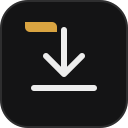
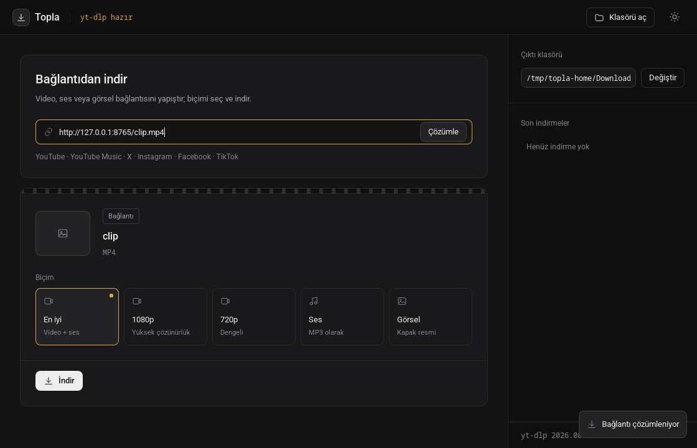

<div align="center">



# Topla

**A desktop media downloader built with MyZig and yt-dlp.**

[](https://github.com/agnogad/topla/releases)
[](https://github.com/agnogad/topla/actions/workflows/release.yml)
[](https://ziglang.org)
[](#build-from-source)
[](LICENSE)

</div>

---

Topla takes a media link, lets you pick a format, and downloads it to a folder
you choose. The interface runs in the operating system's webview while Zig
validates the choices, runs `yt-dlp` off the main thread, and streams progress
back as events. No shell is involved: arguments are passed as an argv array.



## Features

- **Paste a link** from YouTube, YouTube Music, X, Instagram, Facebook, TikTok,
  or any other site supported by yt-dlp.
- **Analyse before downloading** — title, source, duration, uploader, and cover
  image are shown before the download starts.
- **Format choices** — best video with audio, 1080p, 720p, audio-only MP3, or
  cover image. Only whitelisted selectors reach the command line.
- **Live progress** — a thin signal line tracks the download, with cancellation.
- **Output folder** — choose any directory with a native folder picker; the last
  choice is remembered.
- **Recent downloads** — a short history with status, stored with the settings.
- **Themes** — dark and light, with restrained motion that respects
  `prefers-reduced-motion`.

## Downloads

Ready-built binaries are published on the
[releases page](https://github.com/agnogad/topla/releases). The release workflow
builds each target on its own runner:

| Asset | Runner |
| --- | --- |
| `topla-linux-x86_64` | Ubuntu 24.04 |
| `topla-macos-aarch64` | macOS (Apple Silicon) |
| `topla-windows-x86_64.exe` | Windows |

## Prerequisite

Topla drives [yt-dlp](https://github.com/yt-dlp/yt-dlp). Install it so it is on
your `PATH`:

```sh
# Linux / macOS
python3 -m pip install -U yt-dlp

# Windows
winget install yt-dlp.yt-dlp
```

FFmpeg is needed for audio extraction and some format conversions:

```sh
sudo apt-get install ffmpeg     # Debian / Ubuntu
brew install ffmpeg             # macOS
winget install Gyan.FFmpeg      # Windows
```

The app reports `yt-dlp hazır` when the tool is found. If it is missing, install
it and restart Topla.

## Build from source

Requires [Zig 0.17.1](https://ziglang.org/download/). The manifest depends on
MyZig as a relative package, so clone the two repositories side by side:

```sh
git clone https://github.com/agnogad/myzig
git clone https://github.com/agnogad/topla
cd topla
zig build run
```

On Linux, install GTK 3, WebKitGTK 4.1, cairo, and X11 development packages
first:

```sh
sudo apt-get install libgtk-3-dev libwebkit2gtk-4.1-dev libcairo2-dev libx11-dev
```

Cross-compile with the standard Zig target flag:

```sh
zig build -Dtarget=x86_64-windows --prefix zig-out/windows
zig build -Dtarget=aarch64-macos  --prefix zig-out/macos
```

Use `zig build -Doptimize=ReleaseSafe` for a smaller binary; the default `Debug`
build carries full DWARF debug information.

## Keyboard

| Shortcut | Action |
| --- | --- |
| `Enter` in the link field | Analyse the link |
| `Ctrl/Cmd+Enter` | Analyse, or start the download when a result is shown |

## Project structure

```
build.zig, build.zig.zon   Zig build and the relative MyZig dependency
src/main.zig               IPC services, yt-dlp worker, process handling
src/index.html             interface shell and inline SVG icon set
src/styles.css             theme tokens, layout, motion
src/app.js                 link analysis, format choice, progress, history
docs/logo.svg              project logo
```

## Testing

```sh
zig build test
bash scripts/selftest.sh   # needs Xvfb
```

The self-check starts the app under a throwaway X display with `TOPLA_SELFTEST=1`
and reports whether yt-dlp was found. The end-to-end download path was verified
against a local HTTP server serving a short video clip.

## Design and credits

The interface follows [unslop](https://github.com/heydamir/unslop): graphite
chrome, one amber accent, and the film-frame detail as the only material moment.
unslop is by Damir Sokolovsky ([@heydamir](https://x.com/heydamir)), licensed
CC BY 4.0.

Topla is MIT licensed. Downloading media may be subject to the terms of service
of the source platform and local law; use it only for content you are allowed to
save.

---

<div align="center">Built with <a href="https://github.com/agnogad/myzig">MyZig</a> — no JavaScript toolchain, no runtime to install.</div>
